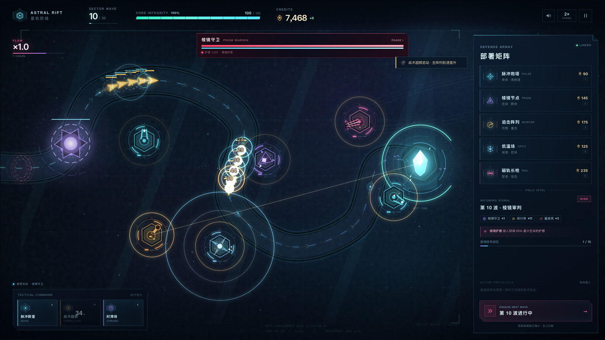

# 星轨防线 · ASTRAL RIFT

一款霓虹科幻风格的网页塔防游戏。动态波次、战术协议构筑、永久星核强化与本地存档，全部运行在浏览器里。



## 启动

项目零依赖、无需构建。

```bash
npm start
# 打开 http://127.0.0.1:4173
```

没有 Node.js 时也可以直接用任意静态服务器：

```bash
python3 -m http.server 4173
```

也可以双击 `index.html` 直接运行；使用本地 HTTP 服务可以获得更稳定的 localStorage 行为。

## 核心内容

- **30 波战役 + 无尽回响**：每 5 波遭遇一个技能与外观都不同的裂隙首领。通关后可继续无尽模式。
- **5 类防御单位**：脉冲炮塔、棱镜节点、迫击阵列、低温场、磁轨长枪。每座可强化到 3 级，支持最前 / 最强 / 最近三种瞄准协议。
- **28 项战术协议**：每波结束后三选一，效果永久叠加，包含连锁、处决、轨道支援、死亡爆破、暴击与核心修复等构筑方向。
- **7 类敌人 + 6 名 Boss**：疾行、重甲、裂变、护盾再生、相位闪现、群体治疗，以及召唤、护盾、折跃、分裂、时滞、终焉多阶段首领机制。
- **动态威胁**：波次构成由种子程序化生成，并叠加过载、装甲、护盾、赏金、静默、狂暴、再生、相位迷雾等 8 种异常协议。
- **星核强化**：每局行动结束都会获得星尘，用于永久提升核心耐久、初始资金、炮塔伤害、建造成本与战术冷却。
- **标准 / 深渊难度**：首次通关后解锁深渊协议，敌人更强，但信用点与星尘收益更高。
- **完整存档**：自动同步当前行动、炮塔、协议、信用点、核心状态与元进度。

## 操作

| 操作 | 功能 |
| --- | --- |
| `1` – `5` | 选择防御单位 |
| 鼠标 / 触控 | 部署；点击已建单位进行选择 |
| `R` | 强化当前选中的单位 |
| `X` / `Delete` | 回收当前选中单位 |
| `Q` / `W` / `E` | 脉冲新星 / 战术超频 / 时滞场 |
| `F` | 1× / 2× 速度切换 |
| `Space` / `P` | 暂停 |
| `Esc` | 取消部署或暂停 |
| 右键 | 取消部署 / 取消选择 |

暂停菜单里可手动保存并退出，也可以调整屏幕震动、泛光层与环境音轨。

## 存档说明

- 存档写入 `localStorage`，键名：`astralRift.save.v2`。
- 元进度单独保存在 `astralRift.meta.v2`，失败不会丢失星尘与永久强化。
- 每 7 秒、每次建塔/强化/清波/选择协议时自动保存。
- 如果在一波进行中关闭页面，继续行动会从该波开始前恢复，保留已获得的信用点、炮塔与核心状态；这是有意设计的检查点规则。

## 视觉与声音

- Canvas 2D 多层渲染：预烘焙星图、动态路径能量、分层泛光、粒子、伤害数字、屏幕震动与冲击帧。
- CSS 玻璃面板、扫描线、噪点、暗角、战术 HUD 与响应式布局。
- 所有音效和背景氛围均由 Web Audio 实时合成，不依赖外部音频文件。
- 首次点击后音频才会启动，这是浏览器的自动播放策略要求。

## 文件结构

```text
.
├── index.html          # 界面骨架、SVG 图标与 HUD
├── styles.css          # 视觉系统、动效与响应式布局
├── js/
│   ├── data.js         # 炮塔、敌人、Boss、协议、波次与元升级数据
│   ├── audio.js        # 程序化 Web Audio 音效与氛围音轨
│   └── game.js         # 引擎、战斗、波次、存档、渲染与输入
├── server.js           # 零依赖静态服务器
├── package.json
└── assets/preview.png
```

## 浏览器建议

建议使用较新的 Chrome / Edge / Safari，窗口宽度 1100px 以上获得完整战术视野；窄屏会压缩侧边面板，竖屏会提示横屏。
